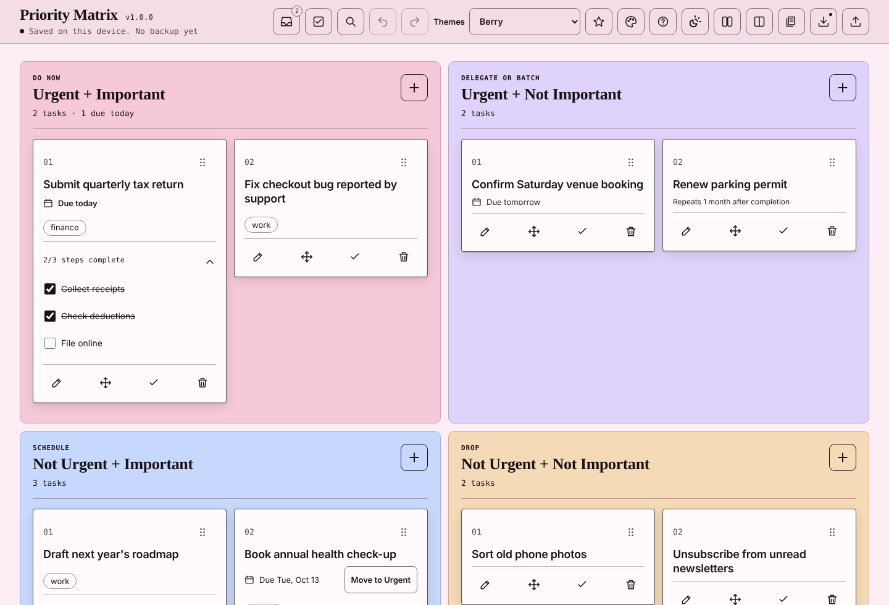
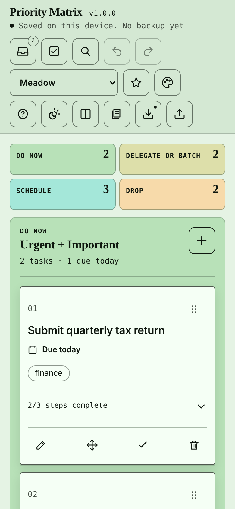

# Priority Matrix

A private, offline Eisenhower matrix in a single HTML file. Drop tasks into four boxes by urgency and importance, put them in order, and tick them off. There's no account, no server and no tracking. Your board lives in your browser.



## Why another to-do app?

Most task apps turn into one long list where everything feels equally pressing. The Eisenhower matrix forces one question per task: *is this urgent, is it important, or neither?* Priority Matrix keeps that question front and centre and stays out of the way otherwise.

| | Urgent | Not urgent |
| --- | --- | --- |
| **Important** | Do now | Schedule |
| **Not important** | Delegate or batch | Drop |

## Getting started

**Use it online.** Open <https://lonelysoul87.github.io/priority-matrix/>. It always has the latest version.

**Or keep it on your computer.** Download `Priority-Matrix-<version>.html` from the [latest release](https://github.com/LonelySoul87/priority-matrix/releases/latest), save it anywhere and open it in your browser. It works with no internet connection.

Nothing to install, nothing to build.

## What it does

**Deciding**

- **Four quadrants that say what to do.** Each box carries its action (Do now, Delegate or batch, Schedule, Drop), and an empty box explains what belongs there.
- **Due dates, if you want them.** A task can carry a day it's due. Cards say "Due tomorrow" or "Overdue", quadrant headings count what's overdue, and a not-urgent task due within two days offers to move to Urgent. Urgency follows the clock instead of a label you have to remember to change.
- **An Inbox for capturing first.** Jot things down without deciding, then sort them one at a time with keys 1 to 6. You can also paste a whole list and review it before adding.

**Doing**

- **Ordering that means something.** Each box is a ranked list. Drag cards by their grip, use the Move button, or use the keyboard.
- **Steps, details and labels.** Break a task into up to 20 checklist steps, add notes (links become clickable), and tag it with up to three labels.
- **Repeating tasks.** Complete a repeating task and a fresh copy comes back after the interval you chose, with its due date moved along.
- **Fast capture.** Press a number to open a box's form, type, press Enter, and keep typing the next task.

**Staying safe**

- **Undo for everything**, with a visible Undo bar after anything that takes a task out of view. History survives a reload.
- **Done and Discarded trays.** Finished and dropped tasks stay recoverable instead of vanishing, and completing a task keeps your place on the board.
- **Backups.** One click downloads the board as a file; restoring asks first and can be undone. A small reminder appears when a backup is overdue.
- **Nothing is overwritten that the app can't read.** If saved data is damaged or comes from a newer version, it's set aside and you choose what to do.
- **Tabs stay in step.** Open the board in two tabs and each one keeps up with the other instead of overwriting it. If both change at once, you choose which version to keep.

**Fitting you**

- **40 built-in themes** in light and dark, plus your own. The theme editor checks text contrast against WCAG AA (4.5:1) before it lets you save.
- **Column or list view**, comfortable or compact spacing, and a phone layout with a 2×2 overview at the top.
- **Search, label filters, saved searches, templates and batch actions** for when the board grows.
- **Clean printing:** the four quadrants in black on white, without buttons.

<p align="center"></p>

## Keyboard shortcuts

Press <kbd>?</kbd> in the app for this list. Single-key shortcuts can be switched off there if they get in the way of a screen reader or voice control.

| Keys | Action |
| --- | --- |
| <kbd>1</kbd> to <kbd>4</kbd> | Add a task to a quadrant |
| <kbd>7</kbd> | Add a task to the Inbox |
| <kbd>/</kbd> | Search |
| <kbd>?</kbd> | Show all shortcuts |
| <kbd>Enter</kbd> | Add or save the task you're typing |
| <kbd>Shift</kbd> + <kbd>Enter</kbd> | New line in a task |
| <kbd>Ctrl</kbd>/<kbd>⌘</kbd> + <kbd>Z</kbd> | Undo |
| <kbd>Ctrl</kbd> + <kbd>Y</kbd> or <kbd>Ctrl</kbd>/<kbd>⌘</kbd> + <kbd>Shift</kbd> + <kbd>Z</kbd> | Redo |
| <kbd>Esc</kbd> | Close the open form, menu, panel or search |

On a focused task card:

| Keys | Action |
| --- | --- |
| <kbd>Alt</kbd> + <kbd>↑</kbd> / <kbd>↓</kbd> | Move up or down within its box |
| <kbd>Alt</kbd> + <kbd>1</kbd> to <kbd>4</kbd> | Move to a quadrant |
| <kbd>Alt</kbd> + <kbd>5</kbd> / <kbd>6</kbd> / <kbd>7</kbd> | Move to Done / Discarded / Inbox |

While sorting the Inbox, <kbd>1</kbd> to <kbd>6</kbd> place the current task.

## Your data

Everything is stored in your browser's `localStorage` on the device you're using. Nothing is sent anywhere, and the file loads no external scripts, fonts or images.

That has a few consequences worth knowing:

1. **Each browser keeps its own board.** Opening the file in a different browser, on another device, or from a different address (for example the hosted copy versus a downloaded file) starts with an empty board. Move a board with a backup.
2. **Clearing site data clears your tasks.** Private or incognito windows forget everything when closed. Some browsers, Safari in particular, may also clear storage for sites you haven't visited in a while.
3. **Back up now and then.** The download button saves a `.json` file; the upload button restores one. The app reminds you when a backup is more than a week old and the board has changed.

The backup format is versioned (currently format 7). Every older format still restores, and newer optional fields such as due dates are ignored by older versions rather than breaking them.

## Accessibility

Priority Matrix is built to work without a mouse and with assistive technology:

- Everything you can do by dragging you can also do with buttons (the Move menu) or the keyboard.
- Cards and buttons have names that say which task they act on, and changes are announced.
- Built-in themes meet WCAG AA contrast in light and dark, and the theme editor won't save a theme that doesn't.
- Windows High Contrast mode keeps selected, pressed and drop-target states visible.
- Touch targets are at least 44 by 44 pixels, and motion is reduced when your system asks for it.

The automated tests include axe-core scans of the main screens. If something doesn't work for you, please open an issue.

## Browser support

The app uses modern CSS (`oklch()` colours, `color-mix()`, `:has()`) and the native `<dialog>` element. It's built for current Chrome, Edge, Firefox and Safari; roughly anything released from 2023 onward should work. Very old browsers will show broken colours.

## Development

There's deliberately no build step. Edit `index.html`, reload the browser, and you're done.

The browser tests use Node's built-in test runner and Playwright:

```sh
npm install
npx playwright install chromium
npm test
```

`APP_FILE=path/to/other.html npm test` runs the same tests against another copy, for example internal build 1.11.2. The same tests run on GitHub Actions for every push.

```
index.html          The whole app: markup, styles and script in one file
tests/              Browser tests and a backup fixture from an early build
docs/               Screenshots and release review notes
CHANGELOG.md        Release notes
```

## Credits

Built by [LonelySoul87](https://github.com/LonelySoul87) with the help of AI design and coding tools (Open Design, OpenAI Codex and Claude).

Several interface icons come from [Lucide](https://lucide.dev) (ISC License); the notice is kept in the source.

## License

[MIT](LICENSE)
